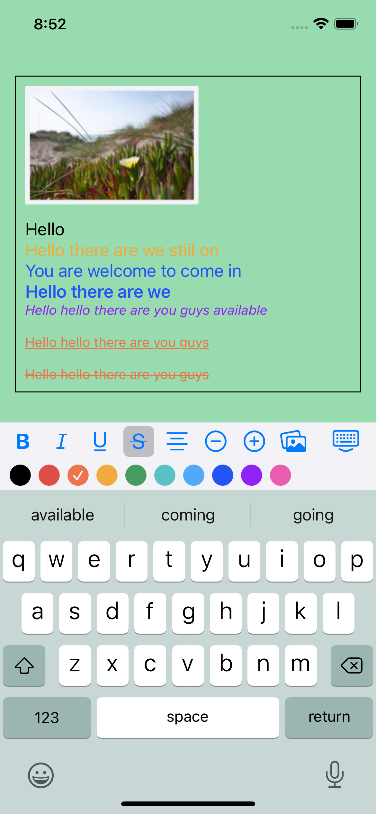

# TextEditor
&nbsp;&nbsp;&nbsp;&nbsp;&nbsp;&nbsp;

A SwiftUI rich text editor backed by `UITextView`, with a formatting toolbar above the keyboard.



## Features

- Bold, italic, underline and strikethrough, which combine freely and keep the font family
- Font size, text color and per-paragraph alignment
- Images inserted at the caret through the system photo picker (no permission prompt)
- Undo and redo for every edit, including formatting
- Toolbar state that follows the selection, with dark mode and VoiceOver support

## Usage

```swift
import SwiftUI
import TextEditor

struct ContentView: View {
    @State private var text = NSAttributedString()

    var body: some View {
        ScrollView {
            RichTextEditor(text: $text, placeholder: "Write something…")
                .padding()
        }
    }
}
```

The editor grows with its content, so place it in a `ScrollView` for long documents.

### Choosing toolbar sections

```swift
RichTextEditor(text: $text, toolbar: [.textStyle, .colorPalette, .history])
```

Pass an empty array to hide the toolbar.

### Driving the editor from your own controls

`RichTextContext` publishes the formatting at the current selection and exposes the same commands as the toolbar.

```swift
@StateObject private var context = RichTextContext()

var body: some View {
    VStack {
        RichTextEditor(text: $text, context: context, toolbar: [])
        Button("Bold") { context.toggle(.bold) }
            .foregroundColor(context.isActive(.bold) ? .accentColor : .primary)
    }
}
```

## Installation

Add the package in Xcode via **File › Add Package Dependencies…**, or in `Package.swift`:

```swift
.package(url: "https://github.com/nothingsh/TextEditor", from: "2.0.0")
```

## Migrating from 1.x

- The minimum platform is now iOS 16.
- `RichTextEditor(richText:onCommit:)` is replaced by `RichTextEditor(text:)` with a `Binding<NSAttributedString>`, which updates on every edit. Use `.onChange(of:)` to save.
- `accessory:` is renamed `toolbar:`, and `EditorSection` gains `.history` (undo and redo).
- The public `Color(hex:)` and `UIColor(hex:)` extensions have been removed.

## Roadmap

- [ ] Headings, lists, quotes and code
- [ ] Links
- [ ] HTML and Markdown import and export
- [ ] Font selection
- [ ] Configurable toolbar items and colors
