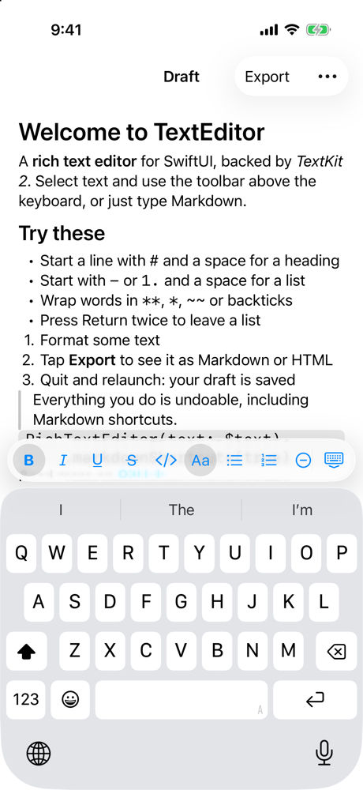
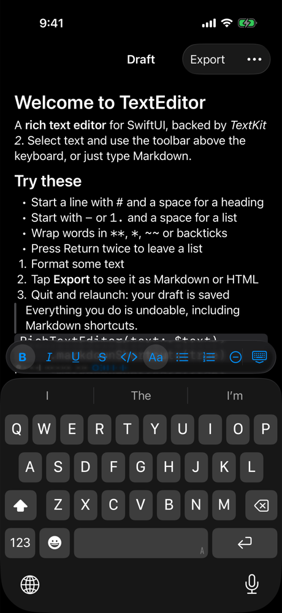

# TextEditor
<a href="https://github.com/nothingsh/TextEditor/actions/workflows/ci.yml"></a>&nbsp;&nbsp;&nbsp;&nbsp;&nbsp;&nbsp;&nbsp;&nbsp;&nbsp;

A SwiftUI rich text editor backed by `UITextView`, with a formatting toolbar above the keyboard.

<p>
  
  &nbsp;
  
</p>

## Features

- Bold, italic, underline, strikethrough and inline code, which combine freely and keep the font family
- Headings, bulleted and numbered lists, checklists, quotes and code blocks, with Return and Delete behaving as in Notes
- Lists nest up to six levels deep with Tab and Shift-Tab; checkboxes tick with a tap
- Links, font size, text color and per-paragraph alignment
- Images inserted at the caret through the system photo picker (no permission prompt)
- Markdown shortcuts while typing: `# `, `- `, `1. `, `[ ] `, `> `, `**bold**`, `*italic*`, `_italic_`, `~~strike~~` and backticks
- Markdown, HTML and lossless archive import and export
- Pasted rich text from Safari, Notes, Pages or Google Docs is rebuilt in the editor's styles, so foreign fonts and sizes stay out
- Find and replace
- Undo and redo for every edit, including formatting
- Hardware keyboard shortcuts for every style, listed in the iPad ⌘ overlay
- A configurable toolbar whose state follows the selection, with dark mode and VoiceOver support

## Usage

```swift
import SwiftUI
import TextEditor

struct ContentView: View {
    @State private var text = NSAttributedString()

    var body: some View {
        ScrollView {
            RichTextEditor(text: $text, placeholder: "Write something…")
                .padding()
        }
    }
}
```

The editor grows with its content, so place it in a `ScrollView`. For long documents, let the editor scroll itself instead: it then only lays out the text on screen, so typing stays fast however long the document gets.

```swift
RichTextEditor(text: $text)
    .scrollsContent()
    .padding(.horizontal)
```

### Keyboard shortcuts

| Shortcut | Action | Shortcut | Action |
|---|---|---|---|
| ⌘B, ⌘I, ⌘U | Bold, italic, underline | ⌥⌘0 | Body |
| ⇧⌘X | Strikethrough | ⌥⌘1, ⌥⌘2, ⌥⌘3 | Headings |
| ⌘E | Inline code | ⇧⌘8, ⇧⌘7, ⇧⌘L | Bulleted, numbered, checklist |
| ⌘K | Link | ⇧⌘U | Tick checklist items |
| ⌘=, ⌘- | Font size | Tab, ⇧Tab, ⌘], ⌘[ | Nest and unnest list items |
| ⌘F, ⌥⌘F | Find, find and replace | ⌘', ⌥⌘C | Quote, code block |

### Markdown shortcuts

Typing Markdown at the start of a paragraph or around a word turns it into formatting, and undo brings the Markdown back. Turn it off with a modifier:

```swift
RichTextEditor(text: $text)
    .markdownShortcuts(false)
```

### Configuring the toolbar

Pick sections in display order, or pass an empty array to hide the toolbar:

```swift
RichTextEditor(text: $text, toolbar: [.textStyle, .blockStyle, .lists, .link, .history])
```

For custom colors or your own buttons, pass a configuration:

```swift
RichTextEditor(text: $text, toolbar: RichTextToolbarConfiguration(
    sections: [.textStyle, .lists, .colorPalette],
    colors: [RichTextColor("Ink", .label), RichTextColor("Brand", .systemIndigo)],
    customActions: [
        RichTextToolbarAction(title: "Quote", systemImage: "text.quote",
                              isActive: { $0.blockStyle == .quote },
                              action: { $0.toggleBlockStyle(.quote) }),
    ]
))
```

To place the toolbar somewhere other than above the keyboard, pass `toolbar: nil` and add `RichTextToolbar(context:configuration:)` yourself.

### Saving and loading

```swift
let markdown = RichTextSerializer.markdown(from: text)
let html = RichTextSerializer.html(from: text)
let data = try RichTextSerializer.archivedData(from: text)

text = RichTextSerializer.attributedString(markdown: markdown)
text = RichTextSerializer.attributedString(html: html)
text = try RichTextSerializer.attributedString(archivedData: data)
```

| Format   | Keeps                                                    | Drops                                |
|----------|----------------------------------------------------------|--------------------------------------|
| Archive  | everything                                               | nothing — use it for drafts          |
| HTML     | blocks, nested lists, checkboxes, inline styles, links, colors, alignment, images | font sizes |
| Markdown | blocks, nested lists, task items, bold, italic, strikethrough, code, links, images | underline, colors, sizes, alignment |

Images are embedded as base64 `data:` URIs in HTML and Markdown. On import, only `data:` URI images are loaded; remote images are never fetched, so Markdown keeps them as a link and HTML drops them.

### Driving the editor from your own controls

`RichTextContext` publishes the formatting at the current selection and exposes the same commands as the toolbar.

```swift
@StateObject private var context = RichTextContext()

var body: some View {
    VStack {
        RichTextEditor(text: $text, context: context, toolbar: [])
        Button("Bold") { context.toggle(.bold) }
            .foregroundColor(context.isActive(.bold) ? .accentColor : .primary)
        Button("Heading") { context.toggleBlockStyle(.heading1) }
    }
}
```

## Example App

`Example/TextEditorExample.xcodeproj` is a small notes app showing the editor, Markdown and HTML export, and draft saving. Open it and run; it uses this package from the parent folder. The project is generated from `Example/project.yml` with [XcodeGen](https://github.com/yonaskolb/XcodeGen).

## Documentation

The package includes a DocC catalog with getting-started, toolbar and serialization guides. In Xcode, choose **Product › Build Documentation**.

## Installation

Requires iOS 16 and Xcode 16 or later.

Add the package in Xcode via **File › Add Package Dependencies…**, or in `Package.swift`:

```swift
.package(url: "https://github.com/nothingsh/TextEditor", from: "2.0.0")
```

## Migrating from 1.x

- The minimum platform is now iOS 16.
- `RichTextEditor(richText:onCommit:)` is replaced by `RichTextEditor(text:)` with a `Binding<NSAttributedString>`, which updates on every edit. Use `.onChange(of:)` to save.
- `accessory:` is renamed `toolbar:`. `EditorSection` gains `.blockStyle`, `.lists`, `.link` and `.history`, and the default toolbar (`EditorSection.allCases`) shows them all; pass the sections you want to keep the 1.x toolbar.
- Building now requires Xcode 16 or later.
- The public `Color(hex:)` and `UIColor(hex:)` extensions have been removed.

## Roadmap

- [x] Headings, lists, quotes and code
- [x] Links
- [x] HTML and Markdown import and export
- [x] Configurable toolbar items and colors
- [x] Markdown shortcuts while typing
- [x] Checklists and nested lists
- [ ] Font selection
- [ ] macOS support
